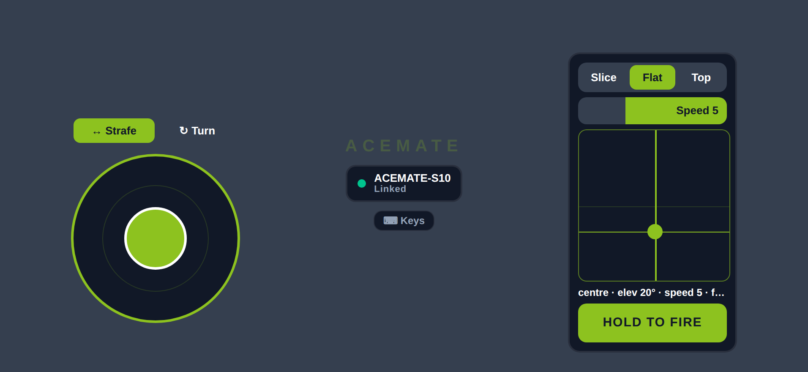
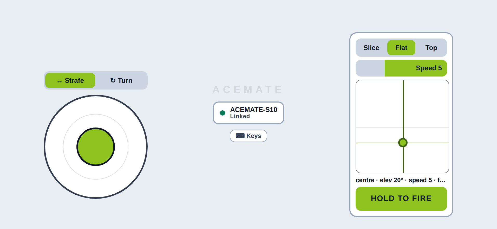
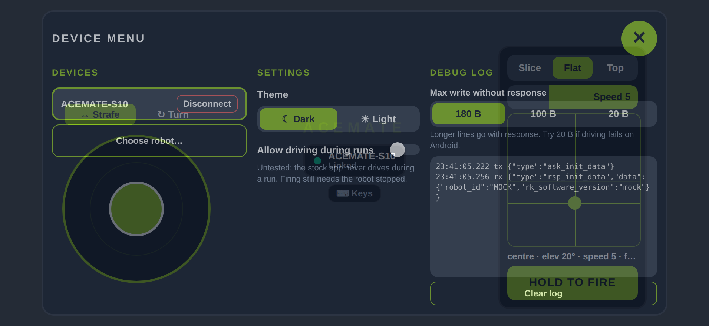
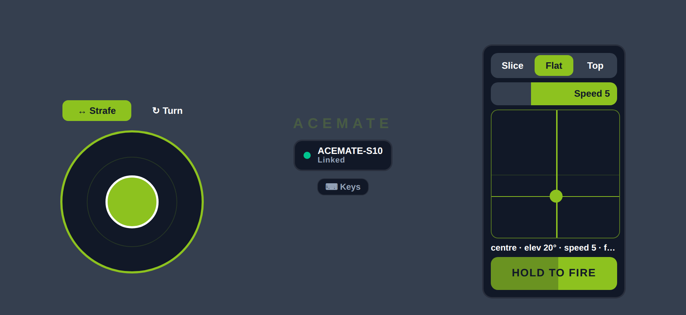

# Acemate Drive

An unofficial controller for the Acemate S10 tennis robot. It drives the robot with a thumbstick, and aims and fires its ball launcher, over Bluetooth Low Energy, from an iPhone or a web browser. This project is not affiliated with, endorsed by or sponsored by Acemate or SwitchBot.

## Safety

**This software moves a heavy machine and fires tennis balls. Use it only with your own robot, on a clear court.**

- Keep clear of the robot and of the launcher's firing arc. Never stand in front of it.
- Keep the robot in sight, and stay close enough to reach it and its power switch.
- Releasing the stick stops the robot. So does leaving the app: switching app or tab, locking the phone or closing the page.
- If the link drops, the robot's firmware stops it by itself within 2 s. Treat that as the last line of defence, not the plan.
- Fire is hold-to-fire. Nothing launches on a tap, and letting go early cancels the shot.

## Getting started

Before connecting from any system, power on the robot and force-quit the stock Acemate app on every phone nearby. The robot accepts only one Bluetooth connection.

There are two web versions:

- https://hjewkes.github.io/acemate/next/ is the new app, the same one that runs natively on iPhone. This guide describes it.
- https://hjewkes.github.io/acemate/ is the classic web app, which stays up while the new one settles. It has its own **Connect** button and a `?mock=1` pretend robot for trying it at a desk.

Web Bluetooth needs HTTPS (or `localhost`). Safari and Firefox do not support it.

### iPhone (native app)

The native app is built from source with Expo. You need a Mac with Xcode, Node 24, the iPhone and a cable for the first install.

1. On the iPhone, turn on Developer Mode: Settings → Privacy & Security → Developer Mode, then restart.
2. Build and install:

   ```sh
   npm ci
   cd apps/controller
   npx expo prebuild --platform ios --clean
   npx expo run:ios --device
   ```

3. If Xcode reports a signing error, open `ios/AcemateDrive.xcworkspace`, go to the target → Signing & Capabilities, tick "Automatically manage signing" and choose your Personal Team. A free Apple ID works, with two limits: an app expires after 7 days, so rebuild to renew it, and only 3 apps can be installed at once. If the bundle id is taken, change `ios.bundleIdentifier` in `app.json` and prebuild again.
4. Trust the developer profile on the phone: Settings → General → VPN & Device Management → your Apple ID → Trust.
5. Open Acemate Drive and allow Bluetooth when asked.

### Android (Chrome)

Open https://hjewkes.github.io/acemate/next/ in Chrome. Tap the device chip, then **Choose robot…**, and pick the `ACEMATE-XXXXX` device in the browser's chooser. Allow Bluetooth and Nearby devices if Android asks.

### Desktop (Chrome or Edge)

Open https://hjewkes.github.io/acemate/next/ in Chrome or Edge on macOS, Windows, Linux or ChromeOS, and connect the same way.

### iPhone (Bluefy browser)

Safari and Chrome on iOS have no Web Bluetooth. Install the free Bluefy browser from the App Store, open https://hjewkes.github.io/acemate/next/ in it, and connect as above.

## Screenshots









_Captured from the web build with a stand-in robot: `npm run export:web && npm run screenshots` in `apps/controller`._

## Screen tour

The drive screen is landscape, with three parts:

- **Left: the stick.** Push up or down to drive forward or back. Sideways either strafes or turns, chosen by the **Strafe / Turn** switch under the stick. The robot runs one motion at a time, so the strongest push wins.
- **Centre: the wordmark and device chip.** The chip shows the link status. Tap it to open the device menu, which has:
  - nearby robots, with connect and disconnect;
  - the theme (dark or light);
  - **Allow driving during runs**;
  - the debug log, with a Clear button.
- **Right: the launcher.**
  - Spin: slice, flat or topspin.
  - Speed from 1 to 10. The bar fills from right to left.
  - The aim pad: across sets direction, and up sets elevation.
  - The fire bar. Hold it until it fills to fire one ball.
- **Top right: the run chip.** It appears while a run is active, showing the mode and the elapsed time. Tap it to stop the run.

## Controls

### Touch

| Control         | Action                                 |
| --------------- | -------------------------------------- |
| Stick           | drive; release to stop                 |
| Strafe / Turn   | choose what sideways on the stick does |
| Spin, speed     | set up the shot                        |
| Aim pad         | set direction and elevation            |
| Fire bar (hold) | fire one ball when the bar fills       |
| Run chip        | stop the run                           |
| Device chip     | open the device menu                   |

### Keyboard

On the web build only. Tap **⌨ Keys** under the device chip for a reminder. Keys do nothing while the device menu is open or while you are typing in a field.

| Key      | Action                                                                    |
| -------- | ------------------------------------------------------------------------- |
| `W`, `S` | forward, back; release to stop                                            |
| `A`, `D` | left, right, following the Strafe / Turn switch                           |
| `Q`, `E` | left, right, in the other mode                                            |
| `←`, `→` | aim direction, one step per press; hold to repeat                         |
| `↑`, `↓` | aim elevation, one step per press; hold to repeat                         |
| `Space`  | hold to fire, like the fire bar; release early to cancel                  |
| `Escape` | stop: halts driving until every key and stick is released, and ends a run |

### Gamepad

On the web build only, for pads with the standard layout.

| Input         | Action                                    |
| ------------- | ----------------------------------------- |
| Left stick    | drive; sideways follows the switch        |
| Right stick   | move the aim; push further to move faster |
| Right trigger | hold to fire                              |
| `B` / `○`     | stop, as `Escape`                         |

Leaving the page (switching tab or window) lets go of every key, stick and fire hold. Hiding or closing the page also ends a run.

## Launching

A launch fires one ball. The app tells the robot to switch to ball-machine mode with your shot (direction, elevation, speed and spin), waits for it to confirm, then starts a one-ball run. The robot fires from wherever it stands, and the run chip shows the run until it ends.

Fire is locked, with the reason shown on the bar, while:

- the robot is not connected;
- the robot is driving, because the shot is aimed from where the robot stands, and a ball fired on the move would go somewhere you did not aim;
- the app is waiting for the robot to confirm the shot;
- a run is already active.

Driving is held at stop during a run unless you turn on **Allow driving during runs** in the device menu.

## Settings and auto-connect

The app remembers your Strafe / Turn choice, your last shot, the theme, the driving-during-runs option and the last robot you connected to.

The iPhone app reconnects to that robot by itself when it opens and when you return to it. If you tap Disconnect, it stays disconnected until you connect from the device menu or open the app again.

In a browser, the app never connects by itself, because the browser's chooser needs a tap. After a reload, the device menu offers **Reconnect <name>**, which opens the chooser for the saved robot only. Hiding the tab stops the robot and drops the link.

## Troubleshooting

- **The robot connects but ignores commands.** Power-cycle the robot, then reconnect.
- **Can't connect, or the robot isn't listed.** Another phone or the stock Acemate app is holding the connection. Only one connection is allowed, so force-quit the stock app everywhere.
- **The iPhone app won't open.** Trust the developer profile: Settings → General → VPN & Device Management → your Apple ID → Trust. If it worked before and stopped after a week, the free signature has expired, so rebuild.
- **Bluetooth permission.** On iPhone, turn on Bluetooth for Acemate Drive (or Bluefy) in Settings → Privacy & Security → Bluetooth. On Android, allow Chrome to use Nearby devices. On desktop, check the browser's site settings and that Bluetooth is on.
- **"Bluetooth not available" in the browser.** Use Chrome, Edge or Bluefy over HTTPS. Safari and Firefox are not supported.

## For developers

- Use Node 24. Node 25 breaks the happy-dom tests.
- The root is an npm workspace with one lockfile: run `npm ci` once at the root. `packages/core` (`@acemate/core`) holds the shared protocol, drive and launcher logic, consumed as TypeScript source by `apps/controller`, `apps/web` and `tools/cli`.
- `tools/cli` (`@acemate/cli`) is a laptop CLI over Node BLE. Run `npx acemate --help` from the root for `scan`, `listen [--watch S]`, `drive`, `pulse`, `launch` (a dry run unless given `--fire`) and `send '<json>' [--watch S]`, which writes one raw request and prints every reply. `send` refuses OTA (any type with `ota` in it, `mcu_ota`, `ap` with purpose `ota`), the `upload` and `trigger_update` paths, `start_calib_extrinsic` and `set_court_profile`. Every frame is logged to `acemate.jsonl`.
- Tests per package: `npm test` and `npm run typecheck` inside it, or both across every workspace from the root.
- From the root: `npm run lint` and `npm run format:check`.
- CI must be green before merge. Work on a feature branch and open a pull request; do not push to `main`.

## Licence and trademarks

MIT. See [LICENSE](LICENSE).

This is an interoperability project for a robot the author owns. No vendor code or assets are included. Acemate is a trademark of its owner, and SwitchBot is a trademark of its owner; they are named here only to say what the software works with. Use at your own risk, and check that doing so is lawful where you live.
