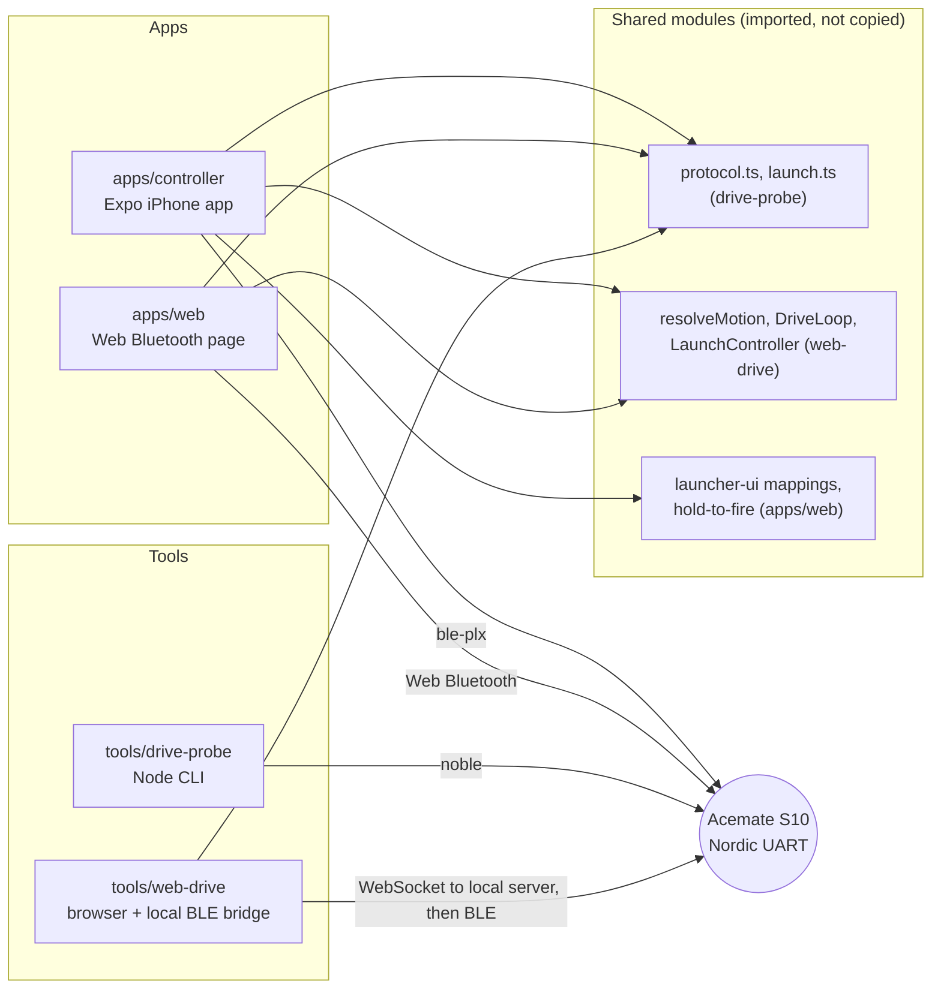

# Acemate Drive

An unofficial controller for the Acemate S10 tennis robot. It drives the robot, and aims and fires its ball launcher, over Bluetooth Low Energy. The protocol was reverse-engineered for interoperability with the author's own robot. This project is not affiliated with, endorsed by or sponsored by Acemate or SwitchBot.

## Safety notice

This software moves a heavy machine and fires tennis balls. Use it only with your own robot, on a clear court.

- Keep clear of the robot and of the launcher's firing arc. Never stand in front of it.
- Keep the robot in sight and stay close enough to reach it and its power switch.
- The firmware has a dead-man stop: if commands stop arriving, the robot halts on its own in under 2 s. That is the last line of defence, not the plan.
- Fire is hold-to-fire in every app: nothing launches on a tap, and releasing early cancels.
- Every app stops the robot when you leave it (blur, background, lock, close) and on an emergency stop.

## Features

- Drive with a thumbstick: forward, back, strafe and turn, at the robot's 50 ms command rate.
- Aim and fire the launcher: direction, elevation, speed and spin, single balls or runs.
- iPhone app, static web app, and two laptop tools, all sharing one tested core.
- Emergency stop that latches until every input is neutral.
- A mock robot in the web app, so the whole UI can be tried at a desk.

## Architecture



Over BLE every app does the same thing: connect to the Nordic UART service, subscribe to notifications, send `ask_init_data`, then write one compact JSON line per message. `motion_control` is written without response every 50 ms; the robot answers with `+==ACE==+`-terminated messages. See [docs/protocol.md](docs/protocol.md).

## Quick starts

Use Node 24 (`nvm install 24 && nvm use 24`). Node 25 breaks the web and controller tests (see the controller troubleshooting section). Run `npm install` inside each package; there is no root workspace.

**iPhone app** (macOS with Xcode, a cable for the first install). Full guide in [apps/controller](apps/controller/README.md).

```sh
cd apps/controller
npm install
npx expo prebuild --platform ios --clean
npx expo run:ios --device
```

**Web app** (any Web Bluetooth browser). Live at https://hjewkes.github.io/acemate/, or locally:

```sh
cd apps/web
npm install
npm run dev          # http://localhost:5173, add ?mock=1 for a pretend robot
```

**Laptop probe** (macOS, robot on, stock app closed). See [tools/drive-probe](tools/drive-probe/README.md).

```sh
cd tools/drive-probe
npm install
npm run scan
npm run drive
```

**Browser drive via local bridge.** See [tools/web-drive](tools/web-drive/README.md).

```sh
cd tools/web-drive
npm install
npm start            # then open http://localhost:8765
```

Force-quit the stock Acemate app on every phone first: the robot accepts one BLE connection.

## Browser support for Web Bluetooth

| Browser                 | Works                                                                   |
| ----------------------- | ----------------------------------------------------------------------- |
| Chrome or Edge, desktop | yes                                                                     |
| Chrome on Android       | yes                                                                     |
| iPhone / iPad           | only in the Bluefy browser; Safari and iOS Chrome have no Web Bluetooth |
| Firefox, Safari         | no                                                                      |

## Repo layout

```
apps/
  controller/     Expo (SDK 55) iPhone app
  web/            static Web Bluetooth app (Vite), published to GitHub Pages
tools/
  drive-probe/    Node CLI: scan, listen, drive, pulse, launch
  web-drive/      browser page plus local BLE bridge server
docs/
  protocol.md     BLE protocol reference
```

## Contributing

- Work on a feature branch and open a pull request; do not push to `main`.
- CI runs on the `check` job and must be green before merge.
- Before opening a PR, run `npm test` and `npm run typecheck` in each package you touched.
- Never commit a real robot ID, BLE MAC or device name. Use `<robot-id>`, `<ble-mac>` and `ACEMATE-XXXXX`.
- Decompiled vendor code and binaries stay out of the repo.

## Legal and trademarks

This is an interoperability project. It talks to a robot the author owns, using a protocol learned by observing that robot and the stock app. No vendor code or assets are included. Acemate is a trademark of its owner, and SwitchBot is a trademark of its owner; they are named here only to say what the software works with. Use at your own risk, and check that doing so is lawful where you live.

## Licence

MIT. See [LICENSE](LICENSE).
